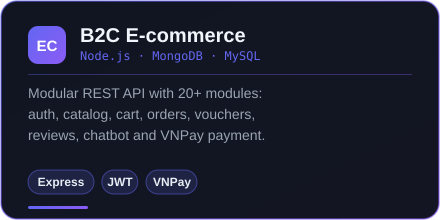
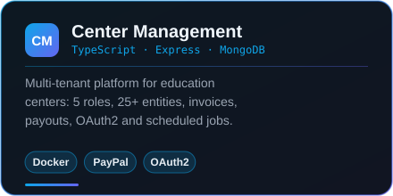
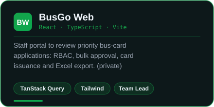
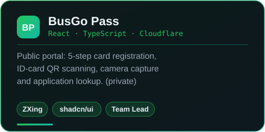
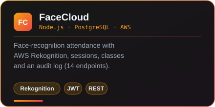
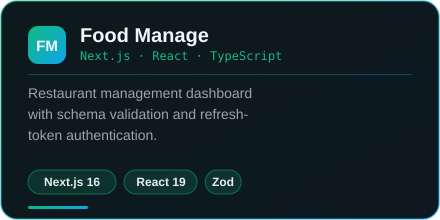

 

## 👋 About Me

I'm **Tung**, an Information Technology student at **Ho Chi Minh City University of Transport (UTH)**, graduating in **2027**. I focus on **backend development** with Node.js and TypeScript and build the **React** interfaces on top of it. I like turning real workflows (e-commerce, education centers, public transport) into clean, maintainable software.

|                     |                                                                               |
| :------------------ | :---------------------------------------------------------------------------- |
| 🎯 **Looking for**  | Fullstack / Backend **internship** and junior opportunities                   |
| 🌱 **Learning**     | System design, Redis caching, testing and CI/CD                               |
| 💬 **Ask me about** | REST API design, JWT & RBAC, payments (VNPay, PayPal), React + TanStack Query |

## 🛠️ Tech Stack

 

## 🚀 Featured Projects

<table>
  <tr>
    <td></td>
    <td></td>
  </tr>
  <tr>
    <td></td>
    <td></td>
  </tr>
  <tr>
    <td></td>
    <td></td>
  </tr>
</table>

Related repos: [B2C web](https://github.com/tunght2005/b2c-ecommerce-web) · [B2C admin](https://github.com/tunght2005/b2c-ecommerce-admin) · [Center portal](https://github.com/tunght2005/center-mangement-system-FE-Portal) · [Center admin](https://github.com/tunght2005/center-mangement-system-FE-admin) · [FaceCloud frontend](https://github.com/tunght2005/facecloud-fe)

## 🐍 Contribution Graph

  <picture>
    <source media="(prefers-color-scheme: dark)" srcset="https://raw.githubusercontent.com/tunght2005/tunght2005/output/github-contribution-grid-snake-dark.svg">
    <source media="(prefers-color-scheme: light)" srcset="https://raw.githubusercontent.com/tunght2005/tunght2005/output/github-contribution-grid-snake.svg">
    
  </picture>

## 📫 Let's Connect

I'm open to internships and collaboration. Reach me by [email](mailto:tunght2005@gmail.com) or [LinkedIn](https://www.linkedin.com/in/t%C3%B9ng-l%C3%AA-015512378/).

<i>"Turning logic into clean code and complex problems into scalable solutions."</i>

